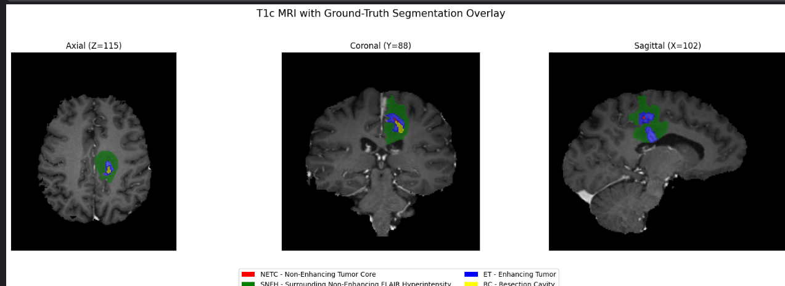
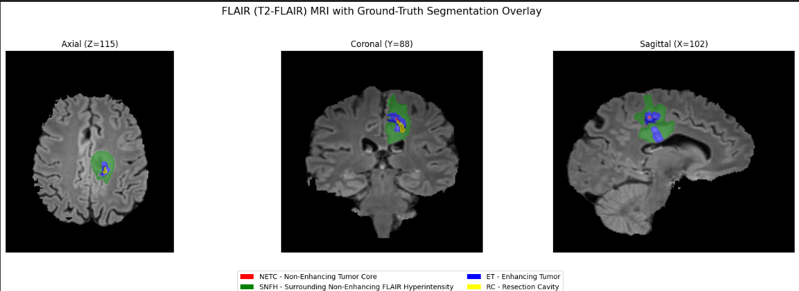

# Notebook 04 — Segmentation Visualization and Analysis

## 1. Objective

This notebook examines the ground-truth segmentation mask supplied with a BraTS 2024 Adult Glioma post-treatment MRI case. The goals are to understand the meaning of each label, visualize the labeled regions in the three anatomical planes, compare them with MRI modalities, and calculate region-wise physical volumes.

**Patient inspected:** `BraTS-GLI-02547-101`

The analysis is an inspection of a single patient. Its observations must not be generalized to the complete dataset.

## 2. MRI Modalities Used

- **T1c (post-contrast T1-weighted):** helps identify contrast-enhancing tissue.
- **FLAIR (T2-FLAIR):** highlights many areas of abnormal fluid-sensitive signal, including edema and other post-treatment abnormalities.

The segmentation mask is a separate voxel-wise annotation volume. Overlaying it on an MRI helps inspect spatial correspondence; it does not independently establish the biological cause of an abnormality.

## 3. Segmentation Label Convention

The BraTS 2024 Adult Glioma post-treatment task uses the following integer encoding:

| Voxel value | Region     | Interpretation                                   |
|:-----------:|------------|--------------------------------------------------|
| 0           | Background | Voxels outside the annotated regions             |
| 1           | NETC       | Non-Enhancing Tumor Core                         |
| 2           | SNFH       | Surrounding Non-Enhancing FLAIR Hyperintensity   |
| 3           | ET         | Enhancing Tumor / Enhancing Tissue               |
| 4           | RC         | Resection Cavity                                 |

These values are task-specific. Older BraTS tasks used different label conventions, so the mapping should not be transferred blindly between datasets or challenge years.

### 3.1 What Each Region Denotes

**NETC — Non-Enhancing Tumor Core (label 1)**

NETC denotes the non-enhancing components of the tumor core. In the BraTS 2024 post-treatment annotation description, this includes regions that appear dark on T1 and T1-Gd images, such as necrotic or cystic components, and other qualifying non-enhancing core regions. It is not synonymous with the complete tumor core: it is one component of the composite Tumor Core (TC).

**SNFH — Surrounding Non-Enhancing FLAIR Hyperintensity (label 2)**

SNFH denotes the surrounding non-enhancing FLAIR-hyperintense abnormality. In the post-treatment setting, the annotation can include edema, infiltrating non-enhancing tumor, gliosis, and radiation-related or other treatment-associated FLAIR signal changes. Consequently, an SNFH label alone does **not** prove tumor recurrence or establish that all labeled voxels are viable tumor.

**ET — Enhancing Tumor / Enhancing Tissue (label 3)**

ET denotes qualifying enhancing tissue on post-contrast T1-Gd imaging. The BraTS annotation protocol describes enhancement while excluding vessels; thick or nodular enhancement is included, whereas typical thin linear treatment-related enhancement along a resection cavity or dura is not treated as ET.

**RC — Resection Cavity (label 4)**

RC denotes a recent or chronic surgical resection cavity, i.e., the space associated with surgical removal of tissue. Its presence is consistent with prior surgery, but the label alone does not describe the patient's full treatment history or establish whether tumor has subsequently recurred.

> **Clinical interpretation caution:** These are radiological annotation categories, not standalone diagnoses. In particular, SNFH may contain a mixture of tumor-related and treatment-related signal abnormalities. A single segmentation mask cannot establish residual disease, progression, or recurrence. Such conclusions require clinical context, longitudinal imaging, and/or other evidence.

## 4. Composite Evaluation Regions

BraTS evaluates composite regions formed by combining the raw labels. Let the segmentation volume be a function

$$
S : \Omega \rightarrow \{0, 1, 2, 3, 4\},
$$

where $\Omega$ is the set of voxel coordinates.

For a label value $k$, define its voxel set as

$$
L_k = \{\, v \in \Omega : S(v) = k \,\}.
$$

The evaluated regions are:

### Enhancing Tumor (ET)

$$
ET = L_3.
$$

Only voxels with label 3 belong to ET.

### Tumor Core (TC)

$$
TC = L_1 \cup L_3,
$$

or equivalently,

$$
TC = \{\, v \in \Omega : S(v) \in \{1, 3\} \,\}.
$$

TC combines NETC and ET. Therefore, **NETC is not the same thing as TC**.

### Whole Tumor (WT)

$$
WT = L_1 \cup L_2 \cup L_3,
$$

or equivalently,

$$
WT = \{\, v \in \Omega : S(v) \in \{1, 2, 3\} \,\}.
$$

WT combines NETC, SNFH, and ET. **RC (label 4) is excluded from WT** and is evaluated separately.

### Resection Cavity (RC)

$$
RC = L_4.
$$

The nested relationship is

$$
ET \subseteq TC \subseteq WT.
$$

Because the raw labels are mutually exclusive, their voxel counts add without overlap:

$$
|TC| = |L_1| + |L_3|,
$$

$$
|WT| = |L_1| + |L_2| + |L_3|.
$$

Here, $|A|$ denotes the number of voxels in set $A$.

## 5. Physical Volume Calculation

If the voxel spacing is $(s_x, s_y, s_z)$ millimeters, the physical volume of one voxel is

$$
V_{\text{voxel}} = s_x \, s_y \, s_z \quad \text{mm}^3.
$$

For a region $R$ containing $N_R$ voxels,

$$
V_R = N_R \, s_x \, s_y \, s_z \quad \text{mm}^3.
$$

Since $1\ \text{mL} = 1000\ \text{mm}^3$,

$$
V_R\ (\text{mL}) = \frac{N_R \, s_x \, s_y \, s_z}{1000}.
$$

For this inspected case, the voxel spacing was $1 \times 1 \times 1$ mm, so each voxel represents $1\ \text{mm}^3$, and the numerical voxel count equals the volume in mm³.

## 6. Results for the Inspected Patient

### 6.1 Individual Labels

| Region | Label | Voxel count | Volume (mm³) | Volume (mL) |
|--------|:-----:|------------:|-------------:|------------:|
| NETC   | 1     | 49          | 49           | 0.049       |
| SNFH   | 2     | 12,902      | 12,902       | 12.902      |
| ET     | 3     | 2,509       | 2,509        | 2.509       |
| RC     | 4     | 369         | 369          | 0.369       |

### 6.2 Composite Regions

| Region | Composition      | Voxel count | Volume (mL) |
|--------|------------------|------------:|------------:|
| ET     | Label 3          | 2,509       | 2.509       |
| TC     | Labels 1 + 3     | 2,558       | 2.558       |
| WT     | Labels 1 + 2 + 3 | 15,460      | 15.460      |
| RC     | Label 4          | 369         | 0.369       |

Sanity checks:

$$
|TC| = 49 + 2509 = 2558,
$$

$$
|WT| = 49 + 12902 + 2509 = 15460.
$$

The values satisfy

$$
|ET| \leq |TC| \leq |WT|.
$$

RC is kept separate and is not added to WT.

### 6.3 Interpretation

For this one patient, SNFH accounts for the largest number of annotated voxels. NETC is very small in this particular mask (49 voxels). This illustrates within-patient label imbalance, but it does not establish the frequency or typical volume of these regions across the dataset. That requires analysis across multiple patients.

## 7. Visualization Procedure

The notebook produced:

1. Raw segmentation views in axial, coronal, and sagittal planes.
2. Color-coded segmentation views using a discrete colormap.
3. Segmentation overlays on T1c MRI.
4. Segmentation overlays on FLAIR MRI.

The displayed slices were selected independently for each anatomical plane by finding the slice with the largest number of non-background voxels in that plane. Therefore, the axial, coronal, and sagittal panels are not guaranteed to intersect at one common 3D coordinate.

The overlays use the MRI as the grayscale background and display non-background segmentation labels with partial transparency. This supports visual inspection of spatial correspondence, not clinical validation.

### 7.1 Overlay Figures

Color legend: **red** = NETC, **green** = SNFH, **blue** = ET, **yellow** = RC.

*Figure 1. T1c MRI with ground-truth segmentation overlay for `BraTS-GLI-02547-101`. Slices shown: axial (Z = 115), coronal (Y = 88), sagittal (X = 102).*

*Figure 2. T2-FLAIR MRI with ground-truth segmentation overlay for `BraTS-GLI-02547-101`, at the same slice positions as Figure 1.*

## 8. Segmentation Evaluation Metrics — Background for Later Notebooks

The following metrics compare a model's predicted region $P$ with the ground-truth region $G$. They were **not calculated in this notebook**, because no model prediction was generated here.

### Dice Similarity Coefficient (DSC)

$$
DSC(P, G) = \frac{2\,|P \cap G|}{|P| + |G|}.
$$

Dice measures overlap between prediction and ground truth. It ranges from 0 to 1, where 1 indicates perfect overlap. If both sets are empty, implementations need an explicit convention for handling the zero denominator.

### Hausdorff Distance (HD95)

For a point $x$ and a set $Y$, let

$$
d(x, Y) = \min_{y \in Y} \lVert x - y \rVert.
$$

For two sets of boundary points $A$ and $B$, the directed Hausdorff distance from $A$ to $B$ is

$$
h(A, B) = \max_{a \in A} d(a, B),
$$

and the symmetric Hausdorff distance is

$$
HD(A, B) = \max\big(h(A, B),\, h(B, A)\big).
$$

HD95 replaces the maximum with the 95th percentile of the combined (symmetric) surface-distance distribution, reducing sensitivity to a small number of extreme outlier points.

In practical medical-image evaluation, surface distances should be computed using physical voxel spacing so that the result is expressed in millimeters rather than raw voxel units. Exact HD95 aggregation conventions can vary by implementation and should be checked when reproducing a benchmark.

## 9. Key Observations and Limitations

- The inspected segmentation contains all four label values, but NETC is represented by very few voxels in this particular case.
- SNFH is the largest annotated region in this case.
- ET, TC, and WT are nested composite regions; RC is evaluated separately.
- T1c and FLAIR provide complementary visual context for inspecting the annotations.
- The mask is a post-treatment annotation. SNFH should not be interpreted as proof of recurrence.
- The results describe one patient only. Dataset-level distributions and patient-to-patient variability will be examined in Notebook 05.

## 10. References

1. **BraTS 2024 challenge paper:** *The 2024 Brain Tumor Segmentation (BraTS) Challenge: Glioma Segmentation on Post-treatment MRI*. [arXiv:2405.18368](https://arxiv.org/abs/2405.18368). See the annotation protocol section for the descriptions of ET, NETC, SNFH, and RC.
2. **BraTS challenge solutions repository:** [BraTS 2023/2024 solutions — Task 1](https://github.com/andre-fs-ferreira/BraTS_2023_2024_solutions/blob/main/BraTS2024_Task1.md). Provides the label encoding and composite evaluation regions.
3. **Independent dataset review:** *Advancing Precision: A Comprehensive Review of MRI Segmentation Datasets from BraTS Challenges (2012–2025)*. [PMC article](https://pmc.ncbi.nlm.nih.gov/articles/PMC11945730/). See the BraTS 2024 Adult Glioma post-treatment dataset section for the four-label mapping and annotation overview.

---

**Notebook status:** Completed.

**Next notebook:** Notebook 05 — Dataset-Level Segmentation Analysis.
