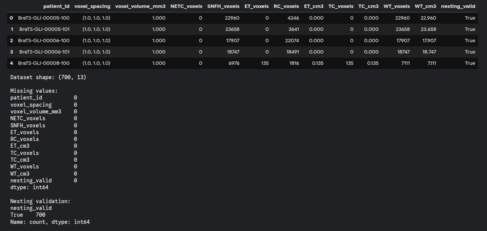
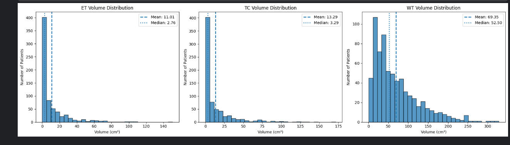
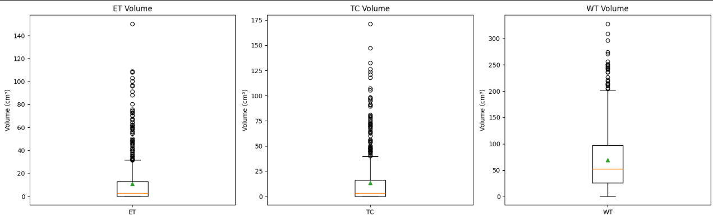
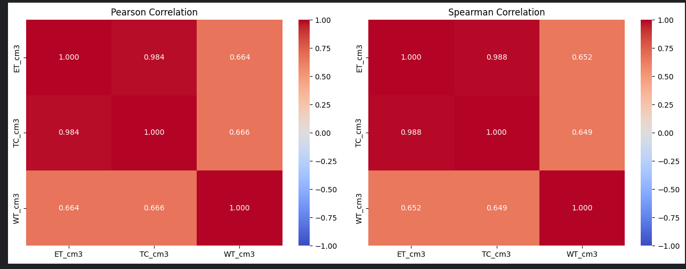
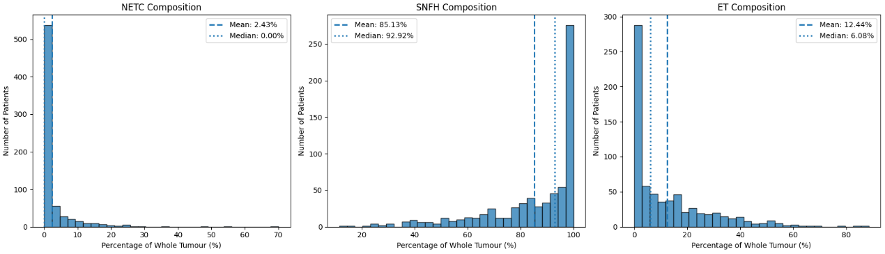
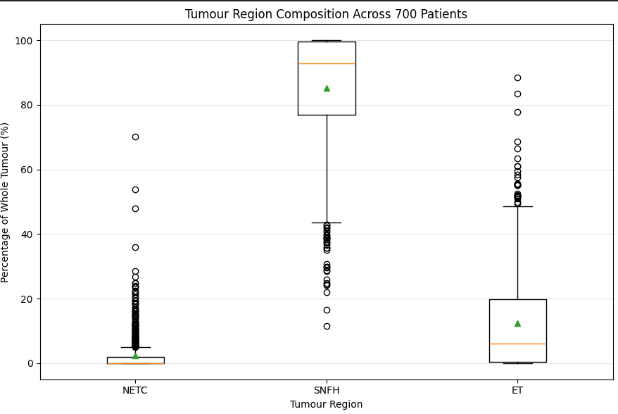

# Notebook 05 — Dataset-Level Segmentation Analysis

- **Notebook:** `05_dataset_statistics.ipynb`
- **Dataset:** BraTS 2024 Adult Glioma (Kaggle copy)
- **Cases analyzed:** 700
- **Status:** Completed
- **Analysis date:** 4 November 2026

---

## 1. Objective

This notebook extends the initial single-case segmentation inspection to all 700 available case directories. The aim is to quantify the occurrence of the BraTS 2024 segmentation labels, measure derived tumor-region volumes, examine inter-case variability, and study the relative composition of the whole-tumor region.

The analysis is descriptive. It characterizes the supplied segmentation annotations; it does not establish clinical relationships, diagnose patients, or evaluate a prediction model.

## 2. Dataset and Label Definitions

The dataset contains 700 case directories. Each directory was expected to contain one segmentation NIfTI file (`*-seg.nii`).

The label mapping used in this notebook is:

| Value | Label      |
|:-----:|------------|
| 0     | Background |
| 1     | NETC       |
| 2     | SNFH       |
| 3     | ET         |
| 4     | RC         |

Derived regions, defined by the set of segmentation labels they contain:

$$
ET = \{\, v : S(v) \in \{3\} \,\}, \qquad
TC = \{\, v : S(v) \in \{1, 3\} \,\}, \qquad
WT = \{\, v : S(v) \in \{1, 2, 3\} \,\}
$$

RC was counted separately and was not included in these derived-region definitions.

Physical volume was calculated from voxel count and voxel spacing:

$$
V_R = N_R \, s_x \, s_y \, s_z \quad \text{mm}^3,
$$

where $N_R$ is the number of voxels in region $R$, and $(s_x, s_y, s_z)$ are the voxel dimensions in millimeters. The result in mm³ was divided by 1000 to obtain cm³ (mL).

## 3. Dataset Integrity and Extraction

| Check                                   | Result       |
|-----------------------------------------|-------------:|
| Case directories discovered             | 700          |
| Segmentation files found                | 700          |
| Missing segmentation files              | 0            |
| Cases with multiple segmentation files  | 0            |
| Successfully processed cases            | 700          |
| Processing errors                       | 0            |
| DataFrame shape                         | `(700, 13)`  |
| Missing values in extracted table       | 0            |
| Cases passing ET ≤ TC ≤ WT              | 700 / 700    |

All 700 cases passed the derived-region nesting check. This confirms internal consistency of the implemented region calculations; it is not an independent validation of annotation quality.

The 13 columns of the extracted table are: `patient_id`, `voxel_spacing`, `voxel_volume_mm3`, `NETC_voxels`, `SNFH_voxels`, `ET_voxels`, `RC_voxels`, `ET_cm3`, `TC_voxels`, `TC_cm3`, `WT_voxels`, `WT_cm3` and `nesting_valid`.

*Figure 1. Preview of the extracted table (first five cases), the dataset shape, the per-column missing-value counts, and the nesting-validation result (700 `True`). In these cases the voxel spacing is 1 × 1 × 1 mm, so one voxel is 1 mm³.*

The extracted table was saved as `../data/processed/dataset_statistics_700.csv`. The path is relative to the notebook's working directory; from the project root, the same file is `data/processed/dataset_statistics_700.csv`.

## 4. Case-Level Presence of Individual Labels

A label was considered present in a case if its voxel count was greater than zero.

| Label | Cases containing label | Percentage of 700 cases |
|-------|-----------------------:|------------------------:|
| NETC  | 353                    | 50.429%                 |
| SNFH  | 700                    | 100.000%                |
| ET    | 579                    | 82.714%                 |
| RC    | 580                    | 82.857%                 |

These percentages describe **case-level label presence**, not the fraction of all tumor voxels assigned to each label.

## 5. Derived Tumor-Region Volume Statistics

All volumes are in cm³.

| Statistic           | ET      | TC      | WT      |
|---------------------|--------:|--------:|--------:|
| Count               | 700     | 700     | 700     |
| Mean                | 11.009  | 13.292  | 69.350  |
| Standard deviation  | 18.756  | 23.086  | 57.407  |
| Minimum             | 0.000   | 0.000   | 0.511   |
| 25th percentile     | 0.141   | 0.175   | 26.133  |
| Median              | 2.763   | 3.292   | 52.501  |
| 75th percentile     | 12.782  | 15.998  | 97.183  |
| Maximum             | 150.383 | 171.479 | 327.711 |

### Observations

- The mean is substantially greater than the median for ET and TC, indicating strongly right-skewed volume distributions.
- WT also has a mean above its median, with a wide spread across cases.
- The large standard deviations indicate considerable inter-case variability.
- Zero minimum values for ET and TC indicate that these derived regions are absent in at least some cases. WT is nonzero in all 700 cases in this extracted table.

## 6. Volume Distribution Visualizations

Histograms and boxplots were generated for ET, TC and WT using all 700 cases.

*Figure 2. Volume distributions for ET, TC and WT across all 700 cases. Dashed line: mean; dotted line: median. The y-axis label in the figure reads "Number of Patients", but each count is a case (scan); see Section 11.*

The histograms show:

- ET and TC volumes concentrated toward the lower end, with long right tails.
- WT volumes spread over a wider range, also with a right tail.
- The mean markers lie to the right of the median markers, consistent with right-skewness.

*Figure 3. Boxplots of ET, TC and WT volumes. The orange line is the median and the green triangle is the mean.*

The boxplots show:

- Wider absolute spread for WT.
- Numerous observations beyond the upper whiskers for all three regions.
- Mean values above the medians.

Boxplot points beyond the whiskers are potential statistical outliers under the conventional 1.5 × IQR rule. They are not automatically erroneous segmentations.

## 7. IQR-Based Outlier Analysis

$$
IQR = Q_3 - Q_1, \qquad L = Q_1 - 1.5\,(IQR), \qquad U = Q_3 + 1.5\,(IQR)
$$

| Region | Q1     | Q3     | IQR    | Lower bound | Upper bound | Outlier count | Percentage |
|--------|-------:|-------:|-------:|------------:|------------:|--------------:|-----------:|
| ET     | 0.141  | 12.782 | 12.641 | −18.821     | 31.744      | 69            | 9.857%     |
| TC     | 0.175  | 15.998 | 15.823 | −23.560     | 39.733      | 67            | 9.571%     |
| WT     | 26.133 | 97.183 | 71.050 | −80.442     | 203.757     | 24            | 3.429%     |

The lower bounds are negative because of the IQR formula; physical volumes themselves cannot be negative. Since all observed volumes are nonnegative, outlier flags in this analysis arise only from exceeding the upper bound.

The flagged cases were retained. An IQR outlier is a statistical designation, not evidence of a segmentation error or a clinical abnormality.

## 8. Ten Cases with the Largest WT Volumes

| Patient/case ID       | ET (cm³) | TC (cm³) | WT (cm³) |
|-----------------------|---------:|---------:|---------:|
| BraTS-GLI-02186-103   | 0.702    | 0.702    | 327.711  |
| BraTS-GLI-02520-101   | 61.573   | 98.490   | 308.285  |
| BraTS-GLI-02079-101   | 21.323   | 23.589   | 296.143  |
| BraTS-GLI-02102-101   | 62.247   | 69.274   | 273.503  |
| BraTS-GLI-02176-103   | 80.346   | 90.875   | 270.649  |
| BraTS-GLI-02194-103   | 32.869   | 33.936   | 255.997  |
| BraTS-GLI-02102-100   | 48.654   | 64.161   | 251.239  |
| BraTS-GLI-02079-100   | 0.256    | 0.377    | 250.920  |
| BraTS-GLI-02268-101   | 41.413   | 47.836   | 248.277  |
| BraTS-GLI-02139-101   | 56.002   | 75.308   | 246.741  |

Two of these cases (`BraTS-GLI-02186-103` and `BraTS-GLI-02079-100`) have a very large WT volume but a very small TC volume. Since $WT = TC + SNFH$ (as volumes), the SNFH volume of each case is the difference. For `BraTS-GLI-02186-103`:

$$
327.711 - 0.702 = 327.009 \ \text{cm}^3
$$

and for `BraTS-GLI-02079-100`:

$$
250.920 - 0.377 = 250.543 \ \text{cm}^3.
$$

Under the region definitions used here, these differences are SNFH volumes. This observation alone does not establish whether the annotation is clinically unusual; image-level inspection would be needed.

## 9. Correlation Between Tumor-Region Volumes

### Pearson correlation

|    | ET    | TC    | WT    |
|----|------:|------:|------:|
| ET | 1.000 | 0.984 | 0.664 |
| TC | 0.984 | 1.000 | 0.666 |
| WT | 0.664 | 0.666 | 1.000 |

### Spearman rank correlation

|    | ET    | TC    | WT    |
|----|------:|------:|------:|
| ET | 1.000 | 0.988 | 0.652 |
| TC | 0.988 | 1.000 | 0.649 |
| WT | 0.652 | 0.649 | 1.000 |

*Figure 4. Pearson (left) and Spearman (right) correlation heatmaps for ET, TC and WT volumes.*

### Interpretation

- ET and TC have a very strong positive association in both measures.
- ET–WT and TC–WT have moderate positive associations.
- Pearson and Spearman values are similar for each pair, so the overall association patterns are similar when using raw magnitudes and ranks.

The high ET–TC association is unsurprising because ET is a component of TC. Similarly, TC is a component of WT:

$$
V(TC) = V(NETC) + V(ET), \qquad V(WT) = V(NETC) + V(SNFH) + V(ET)
$$

The correlations are therefore partly influenced by the mathematical nesting of the regions. They should not be interpreted as independent biological discoveries or causal relationships.

## 10. Tumor Composition Analysis

For each case, the fraction of WT occupied by each component was calculated:

$$
P_{NETC} = \frac{V(NETC)}{V(WT)}, \qquad
P_{SNFH} = \frac{V(SNFH)}{V(WT)}, \qquad
P_{ET} = \frac{V(ET)}{V(WT)}
$$

The fractions were converted to percentages. RC was excluded because it is not part of the WT definition used in this notebook.

By construction, $P_{NETC} + P_{SNFH} + P_{ET} = 1$ (100%) for every case with $V(WT) > 0$, which holds for all 700 cases (minimum WT is 0.511 cm³). The notebook confirmed numerically that all compositions sum to 1, within floating-point precision.

### Case-Level Composition Statistics

| Statistic           | NETC (%) | SNFH (%) | ET (%) |
|---------------------|---------:|---------:|-------:|
| Count               | 700      | 700      | 700    |
| Mean                | 2.433    | 85.126   | 12.441 |
| Standard deviation  | 6.015    | 18.360   | 15.379 |
| Minimum             | 0.000    | 11.498   | 0.000  |
| 25th percentile     | 0.000    | 77.040   | 0.309  |
| Median              | 0.002    | 92.917   | 6.076  |
| 75th percentile     | 2.004    | 99.650   | 19.893 |
| Maximum             | 70.104   | 100.000  | 88.502 |

The mean percentages sum to 100% (up to rounding). The medians are calculated independently for each component and are not expected to sum to 100%.

*Figure 5. Distribution of each component's share of WT across the 700 cases. Dashed line: mean; dotted line: median. The NETC median is 0.002%, shown as 0.00% in the legend because of rounding.*

*Figure 6. Boxplot of each component's percentage of WT. The orange line is the median and the green triangle is the mean.*

### Observations

- SNFH has the largest mean and median contribution to WT in this dataset.
- The median SNFH contribution is 92.917%, while the mean is 85.126%.
- NETC has a median contribution close to zero (0.002%); its mean is higher (2.433%), reflecting many very small or zero contributions and a smaller number of larger contributions.
- ET also shows substantial variability: its mean is 12.441% and its median is 6.076%.
- The histograms and boxplots show that composition varies considerably between cases. NETC and ET have outliers on the high side, whereas SNFH, which dominates most cases, has its outliers on the low side.

The ten cases displayed by the descending SNFH-percentage query all had 100% SNFH contribution (0% NETC and 0% ET). This is a tie at the maximum, not evidence that these are uniquely distinct cases.

## 11. Research Observations and Limitations

### Main findings

1. All 700 available case directories had exactly one segmentation file, and all were processed successfully.
2. Every case passed the internal ET ≤ TC ≤ WT volume-nesting check.
3. SNFH was present in all 700 cases; NETC, ET and RC were present in 50.429%, 82.714% and 82.857% of cases, respectively.
4. ET, TC and WT volumes exhibited substantial inter-case variability and right-skewed distributions.
5. The IQR method flagged 69 ET, 67 TC and 24 WT observations; these were retained.
6. ET and TC volumes were very strongly correlated, while associations with WT were moderate.
7. SNFH contributed the largest average share of WT in the case-level composition analysis.

### Limitations and cautions

- These are descriptive statistics of the 700 case directories available in this dataset copy. They should not automatically be treated as population-level clinical estimates.
- Several case IDs share a prefix (for example `BraTS-GLI-00008-100` to `-103`), which suggests multiple scans per subject. The figure axes say "patients", but each unit analyzed here is a case (scan). Check the IDs against dataset metadata before constructing train/validation/test splits; if multiple scans belong to the same subject, all such scans must remain in one split to prevent leakage.
- The analysis does not verify annotation quality or clinical correctness. Large-volume and IQR-flagged cases require image-level inspection before any quality judgment.
- Correlations among ET, TC and WT are partly induced by their nested definitions.
- Case-level composition percentages are not the same as pooled voxel percentages across the entire dataset.
- No model was trained or evaluated in this notebook. Dice, HD95 and other predictive metrics remain part of the later model-evaluation stage.

## 12. Output Artifact

The extracted case-level statistics are stored in `data/processed/dataset_statistics_700.csv` (path relative to the project root).

The CSV contains one row per case and the extracted label counts, derived-region voxel counts and volumes, voxel-spacing metadata, and the nesting-validation flag. Composition columns were added to the in-memory DataFrame during this notebook; unless the CSV was saved again after Cell 31, those composition columns may not be present in the saved CSV.

## 13. Conclusion

Notebook 05 establishes a reproducible dataset-level descriptive baseline for the 700 available BraTS 2024 glioma cases. It moves the project beyond visual inspection of individual scans and quantifies label presence, tumor-region volumes, inter-case variability, outliers, correlations and tumor composition.

The next stage can move from dataset understanding to model-focused exploration: selecting a suitable 3D segmentation baseline, understanding its preprocessing and inference requirements, and evaluating predictions with region-wise metrics and qualitative error analysis.
